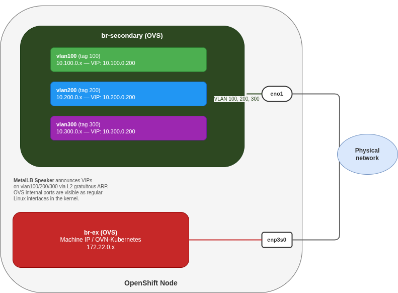

# ocp-vlan-segmentation

Helm chart for deploying VLAN-based network segmentation on OpenShift with MetalLB L2.
Creates per-VLAN interfaces (OVS bridge or VLAN subinterfaces), MetalLB pools, L2Advertisements, and optional test workloads.

## Requirements

- OpenShift 4.18+ (NMState ≥ 2.2 for per-interface forwarding)
- MetalLB operator installed
- NMState operator installed
- Helm 3
- A secondary NIC (or bond) dedicated to VLAN traffic - the primary NIC remains enslaved to `br-ex` for cluster and machine network traffic. The scenario should work also with a single NIC with `br-ex` properly configured.

## Architecture

The chart provisions VLAN interfaces on the secondary NIC, assigns per-node IPs with forwarding enabled, and configures MetalLB to bind VIPs to each interface:



Two approaches are available - the chart supports both via `bridgeType`:

| | `ovs-bridge` (default) | `vlan-subinterfaces` |
|---|---|---|
| How | OVS bridge + access-tagged internal ports | Linux VLAN subinterfaces on the NIC |
| Bridge NNCP | Yes (cluster-wide) | Not needed |
| Interface type in NMState | `ovs-interface` | `vlan` |
| KubeVirt / localnet ready | Yes (bridge-mapping included) | No |
| MetalLB config | Identical | Identical |

Choose `vlan-subinterfaces` when the only requirement is per-VLAN service exposure via MetalLB.
Choose `ovs-bridge` when KubeVirt VMs also need connectivity to the physical VLANs via OVN localnet (bridge-mapping).

## Configuration

Edit `helm/vlan-segmentation/values.yaml` before deploying.

**Mandatory changes:**

| Value | Description | Example |
|---|---|---|
| `physicalInterface` | Secondary NIC name on your nodes | `eno1`, `ens3f0`, `bond0` |
| `nodes[*].name` | Node hostnames (must match `kubernetes.io/hostname`) | `worker-0`, `worker-1` |
| `nodes[*].vlans[*].ip` | Per-node IP on each VLAN | `10.100.0.10` |
| `vlans[*].poolStart/poolEnd` | MetalLB VIP range per VLAN | `10.100.0.200`–`10.100.0.210` |

**Optional:**

| Value | Description | Default |
|---|---|---|
| `bridgeType` | `ovs-bridge` or `vlan-subinterfaces` | `ovs-bridge` |
| `ovsBridge.name` | OVS bridge name | `br-secondary` |
| `ovsBridge.bridgeMapping.localnet` | Localnet name for OVN bridge-mapping | `localnet-br-secondary` |
| `test.enabled` | Deploy test workloads (one echo pod + LoadBalancer Service per VLAN) | `true` |
| `nodeSelector` | Node selector for the bridge NNCP | `node-role.kubernetes.io/worker: ""` |

## Deploy

```bash
# OVS bridge approach (default)
make deploy-ovs

# VLAN subinterfaces approach
make deploy-vlan
```

This creates:
- NNCP(s) for VLAN interfaces (+ OVS bridge if applicable)
- Per-node NNCPs with IP assignments and `forwarding: true`
- MetalLB IPAddressPools and L2Advertisements
- Test workloads (if `test.enabled: true`): one `agnhost netexec` pod + LoadBalancer Service per VLAN

Wait for all NNCPs to be `Available`:

```bash
oc get nncp -w
```

## Teardown

```bash
make teardown
```

This sets all NNCPs to `state: absent`, waits for NMState to reconcile, then uninstalls the Helm release.

> **Note:** when switching between approaches (e.g., from `vlan-subinterfaces` to `ovs-bridge`), always run `make teardown` first and verify that the old interfaces are fully removed before deploying the new approach. NMState cannot change an interface's type in place.

## Test

With `test.enabled: true` (default), the chart deploys an `agnhost netexec` pod per VLAN, exposed as a LoadBalancer Service on port 80.

### Check services are up

```bash
oc get svc -A -l app.kubernetes.io/instance=vlan-seg
```

Expected output:

```
NAMESPACE              NAME           TYPE           CLUSTER-IP       EXTERNAL-IP    PORT(S)
vlan-seg-test-vlan100  echo-vlan100   LoadBalancer   172.30.x.x       10.100.0.200   80/TCP
vlan-seg-test-vlan200  echo-vlan200   LoadBalancer   172.30.x.x       10.200.0.200   80/TCP
```

### Testing from an external client

For a full end-to-end test, use a client on the VLAN subnet (e.g., a device, VM, or Raspberry Pi connected to the same network segment as the nodes' VLAN interfaces):

**Same-VLAN access** (should work):

```bash
# Client has 10.100.0.50/24 on VLAN 100
curl -s http://10.100.0.200/
```

**Cross-VLAN access** (demonstrates the security gap):

```bash
# Client is ONLY on VLAN 100, but routes VLAN 200 traffic through a node
ip route add 10.200.0.0/24 via 10.100.0.10 dev eth0.100

curl -s http://10.200.0.200/
# Returns HTTP 200 - a VLAN 100 client reached a VLAN 200 service
```

This succeeds because the nftables DNAT rule rewrites the destination (VIP → ClusterIP) before the routing decision, making the cross-VLAN access indistinguishable from legitimate forwarding. The DNAT map matches on `{IP, protocol, port}` only - the ingress interface is not checked.

## Security note

The nftables DNAT rules installed by OVN-Kubernetes are **interface-agnostic**: a client on VLAN 100 can reach a VIP intended for VLAN 200 by routing through an OpenShift node.

**Mitigation:** install a pre-filter nftables table at `priority dstnat - 1` (before OVN's DNAT) that drops traffic arriving on a VLAN interface with a destination outside its own subnet:

```nft
table inet vlan-isolation {
    chain prerouting {
        type filter hook prerouting priority dstnat - 1; policy accept;
        iifname "vlan100" ip daddr != 10.100.0.0/24 counter drop
        iifname "vlan200" ip daddr != 10.200.0.0/24 counter drop
    }
}
```

Deploy via MachineConfig (a systemd service that applies the rules at boot). Use a separate table - OVN-Kubernetes reconciles its own `inet ovn-kubernetes` table and would delete foreign rules.
