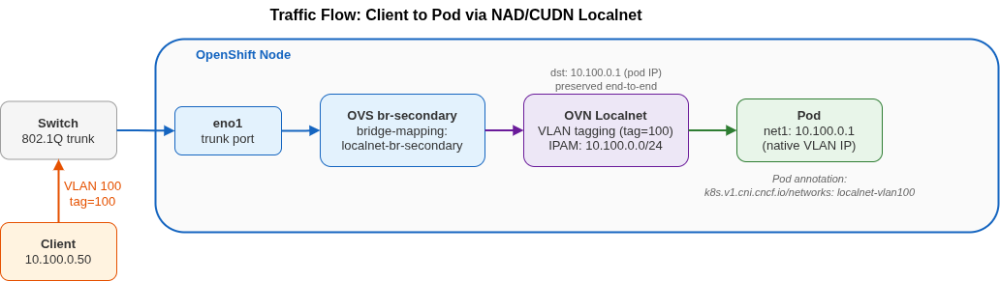

# CUDN Segmentation

Helm chart for deploying VLAN connectivity using **ClusterUserDefinedNetwork (CUDN)** with OVN localnet topology on OpenShift.

Pods get a **secondary network interface** (`net1`) directly on the physical VLAN - no VIPs, no MetalLB, no DNAT. The pod *is* on the VLAN, and traditional network controls (firewalls, ACLs) work as expected.

## Requirements

- OpenShift 4.18+ (ClusterUserDefinedNetwork API)
- NMState operator installed
- OVN-Kubernetes (default CNI on OpenShift)
- Helm 3
- A secondary NIC (or bond) dedicated to VLAN traffic

## How It Works

1. An **OVS bridge** is created on every worker node via NNCP, with the physical NIC as trunk port and a **bridge-mapping** that connects OVN to the physical infrastructure
2. A **ClusterUserDefinedNetwork (CUDN)** is created per VLAN - it tells OVN to auto-generate a **NetworkAttachmentDefinition (NAD)** in every namespace that matches a label selector
3. Pods in those namespaces attach to the NAD via annotation (`k8s.v1.cni.cncf.io/networks`) and receive a secondary interface on the physical VLAN

Unlike the MetalLB scenario, **no per-node IP** and **no IP forwarding** is needed - OVN handles the VLAN tagging internally through the localnet topology. No per-VLAN OVS access ports are created on the bridge either.

## Architecture



## Configuration

Edit `helm/cudn-segmentation/values.yaml` before deploying.

**Mandatory changes:**

| Value | Description | Example |
|---|---|---|
| `physicalInterface` | Secondary NIC name on your nodes | `eno1`, `ens3f0`, `bond0` |
| `vlans[*].id` | VLAN IDs | `100`, `200` |
| `vlans[*].subnet` | VLAN subnet CIDR - OVN IPAM allocates IPs from this range | `10.100.0.0/24` |

**Optional:**

| Value | Description | Default |
|---|---|---|
| `ovsBridge.name` | OVS bridge name | `br-secondary` |
| `ovsBridge.bridgeMapping.localnet` | Localnet name for OVN bridge-mapping | `localnet-br-secondary` |
| `namespaceLabel` | Label key on namespaces for CUDN selector | `vlan-network` |
| `test.enabled` | Deploy test workloads (one pod per VLAN) | `true` |
| `nodeSelector` | Node selector for the bridge NNCP | `node-role.kubernetes.io/worker: ""` |

## Deploy

```bash
make deploy
```

This creates:
- An OVS bridge NNCP with bridge-mapping
- One ClusterUserDefinedNetwork per VLAN
- Test workloads (if `test.enabled: true`): one namespace + deployment per VLAN

Wait for the NNCP to be `Available`:

```bash
oc get nncp -w
```

## Verify

### 1. Check the CUDN

```bash
oc get clusteruserdefinednetwork
```

Expected:

```
NAME                       AGE
cudn-seg-localnet-vlan100  1m
cudn-seg-localnet-vlan200  1m
```

### 2. Check the auto-generated NAD

The CUDN auto-generates a NAD in every namespace matching the label selector:

```bash
oc get net-attach-def -n cudn-seg-test-vlan100
```

Expected:

```
NAME                       AGE
cudn-seg-localnet-vlan100  1m
```

### 3. Check the pod has a secondary interface

```bash
oc exec -n cudn-seg-test-vlan100 deploy/echo-vlan100 -- ip link show net1
```

The `net1` interface is the pod's secondary interface, connected to VLAN 100 via the OVN localnet topology.

### 4. Verify the IP assignment

OVN IPAM automatically assigns an IP from the subnet range defined in the CUDN (`lifecycle: Persistent` keeps the IP across pod restarts):

```bash
oc exec -n cudn-seg-test-vlan100 deploy/echo-vlan100 -- ip addr show net1
```

Expected output (IP from the `10.100.0.0/24` subnet):

```
3: net1: <BROADCAST,MULTICAST,UP> mtu 1500 ...
    inet 10.100.0.1/24 brd 10.100.0.255 scope global net1
```

Then verify connectivity from a device on the physical VLAN:

```bash
# From a device on VLAN 100
ping 10.100.0.1
```

## Teardown

```bash
make teardown
```

This removes the CUDNs and the OVS bridge. The auto-generated NADs are deleted automatically when the CUDN is removed.

## Security Note

With CUDN localnet, the security model is simpler than MetalLB:

- **No DNAT**: traffic goes directly to the pod's VLAN IP - no nftables translation, no cross-VLAN DNAT risk
- **No forwarding needed**: the node does not act as a router between VLANs
- **External firewalls work**: traffic is native on the VLAN, so L3 firewalls between VLANs can enforce isolation
- **Standard network segmentation**: the pod is on the VLAN just like any other device - same rules, same visibility

The main trade-off: no Kubernetes Service abstraction. The pod has a fixed IP on the VLAN, not a VIP with load balancing. Use this approach for fixed workloads with strict isolation requirements (OT/industrial, dedicated network zones).
