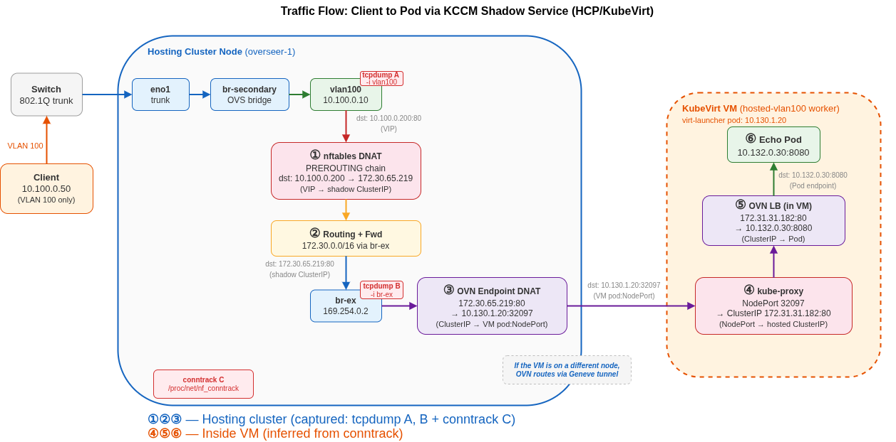

# HCP Segmentation using MetalLB

VLAN-segmented service exposure on OpenShift using **Hosted Control Planes (HCP)** with KubeVirt.

Each hosted cluster runs as VMs on a hosting cluster. Services inside the hosted cluster are exposed on a dedicated physical VLAN via KCCM shadow services and MetalLB on the hosting cluster - one VLAN per tenant, full isolation at the infrastructure level.

## Requirements

- OpenShift 4.18+
- ACM / MultiClusterEngine with Hypershift enabled
- MetalLB operator installed on the hosting cluster
- NMState operator installed on the hosting cluster
- OpenShift Virtualization (KubeVirt / CNV) installed
- Helm 3
- `hcp` CLI (matching the MCE version)
- A secondary NIC (or bond) as trunk port carrying the target VLANs

## How It Works

1. The **hosting cluster** provides the shared network infrastructure - OVS bridge, per-VLAN interfaces, MetalLB pools - using the same chart as the MetalLB L2 scenario (`namespace-segmentation`)
2. A **ClusterUserDefinedNetwork (CUDN)** with LocalNet topology is created per VLAN, giving hosted cluster worker VMs a secondary interface on the physical VLAN
3. The `hcp` CLI creates a **HostedCluster** with KubeVirt VMs connected to the CUDN via `--additional-network`
4. When a LoadBalancer Service is created inside the hosted cluster, **KCCM** creates a shadow service on the hosting cluster - MetalLB assigns a VIP from the VLAN pool and announces it via L2

**Traffic flow:** External client → MetalLB VIP → nftables DNAT → shadow ClusterIP → OVN → VM NodePort → kube-proxy (inside VM) → pod.

> **Alternative: CUDN inside the hosted cluster.** This scenario uses MetalLB for service exposure, but a CUDN-only approach is also possible. Since the VM worker already has L2 presence on the VLAN (via the hosting cluster's CUDN), you can configure bridge-mappings and a CUDN with localnet topology *inside* the hosted cluster - giving pods a secondary interface directly on the physical VLAN. This eliminates MetalLB, DNAT, and shadow services entirely, with the same security benefits as the bare-metal CUDN approach (see [CUDN Segmentation](../cudn-segmentation/README.md)). The trade-off is additional networking configuration inside the hosted cluster (OVS bridge + bridge-mappings on the VM's secondary interface).

## Architecture



## Configuration

The network infrastructure (OVS bridge, VLANs, MetalLB pools) is configured in `../namespace-segmentation/helm/vlan-segmentation/values.yaml` - see the [MetalLB L2 Segmentation README](../namespace-segmentation/README.md) for details.

The per-cluster Helm chart (`helm/hcp-cluster/values.yaml`) has these values:

| Value | Description | Default |
|---|---|---|
| `clusterName` | Name of the hosted cluster | `hosted-vlan100` |
| `vlanId` | VLAN ID for this cluster's CUDN | `100` |
| `localnet` | Localnet name (must match hosting cluster bridge-mapping) | `localnet-br-secondary` |
| `test.enabled` | Deploy test workloads (echo pod + LoadBalancer Service) | `true` |
| `test.image` | Test pod image | `registry.k8s.io/e2e-test-images/agnhost:2.39` |
| `test.port` | Test pod port | `8080` |

Makefile variables for cluster sizing:

| Variable | Default | Description |
|---|---|---|
| `VM_CORES` | `4` | vCPUs per worker VM |
| `VM_MEMORY` | `8Gi` | RAM per worker VM |
| `NODE_POOL_REPLICAS` | `1` | Number of worker VMs per cluster |
| `INFRA_RELEASE` | `vlan-seg` | Helm release name for shared infra |

## Deploy

```bash
# Full deploy: infra + all clusters
make deploy

# Or step by step:
make deploy-infra        # Shared network infra (OVS bridge, MetalLB)
make deploy-vlan100      # CUDN + HCP cluster + test workloads (VLAN 100)
make deploy-vlan200      # Same for VLAN 200
```

This creates:
- Shared network infrastructure (reuses the `namespace-segmentation` chart with `test.enabled=false`)
- One CUDN per VLAN (LocalNet topology with the hosting cluster's bridge-mapping)
- One HostedCluster per VLAN (KubeVirt VMs with `--additional-network`)
- Test workloads (if `test.enabled: true`): echo pod + LoadBalancer Service inside each hosted cluster

To add a new cluster, add an entry to `CLUSTERS` in the Makefile:

```makefile
CLUSTERS := hosted-vlan100:100 hosted-vlan200:200 hosted-vlan300:300
```

This generates `deploy-vlan300` / `teardown-vlan300` targets automatically.

## Verify

### 1. Check cluster status

```bash
make status
```

Or individually:

```bash
oc get hostedcluster,nodepool -n clusters
```

### 2. Check shadow services on the hosting cluster

```bash
oc get svc -n clusters-hosted-vlan100
oc get svc -n clusters-hosted-vlan200
```

### 3. Test connectivity from the VLAN

```bash
# From a client on VLAN 100
curl http://10.100.0.200

# From a client on VLAN 200
curl http://10.200.0.200
```

## Teardown

```bash
# Full teardown (all clusters + infra)
make teardown

# Or one at a time:
make teardown-vlan100
make teardown-vlan200
make teardown-infra
```

> **Note:** If the network infra is shared with the MetalLB L2 scenario, skip `teardown-infra`.

## Security Note

The same cross-VLAN DNAT vulnerability from the MetalLB L2 scenario applies here - the hosting cluster's nftables DNAT rules are interface-agnostic. Enable `vlanIsolation.enabled: true` in the shared infrastructure values to deploy the nftables pre-filter. See the [MetalLB L2 Segmentation README](../namespace-segmentation/README.md#security-note) for details.
