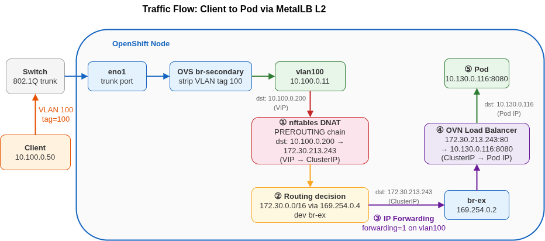

# MetalLB L2 Segmentation

Helm chart for deploying VLAN-based network segmentation on OpenShift with **MetalLB L2**.

Services get a **VIP on the physical VLAN** via MetalLB L2Advertisement - traffic arrives on the VLAN interface, gets DNAT'd to the pod's ClusterIP, and is forwarded internally by OVN-Kubernetes. Full Kubernetes Service API (load balancing, health checks, selectors) is preserved.

## Requirements

- OpenShift 4.18+ (NMState ≥ 2.2 for per-interface forwarding)
- MetalLB operator installed
- NMState operator installed
- Helm 3
- A secondary NIC (or bond) dedicated to VLAN traffic

## How It Works

1. An **OVS bridge** (or VLAN subinterfaces) is created on every worker node via NNCP, with the physical NIC as trunk port
2. **Per-node IPs** are assigned on each VLAN interface via individual NNCPs, with `ipv4.forwarding: true` so the node can route between the VLAN and the cluster network
3. **MetalLB IPAddressPools** define VIP ranges per VLAN, and **L2Advertisements** bind each pool to the corresponding VLAN interface - MetalLB responds to ARP on the VLAN for the VIP
4. Traffic flow: external client → ARP for VIP → MetalLB speaker → nftables DNAT (VIP → ClusterIP) → OVN → pod

Two infrastructure approaches are available - the chart supports both via `bridgeType`:

| | `ovs-bridge` (default) | `vlan-subinterfaces` |
|---|---|---|
| How | OVS bridge + access-tagged internal ports | Linux VLAN subinterfaces on the NIC |
| Bridge NNCP | Yes (cluster-wide) | Not needed |
| Interface type in NMState | `ovs-interface` | `vlan` |
| KubeVirt / localnet ready | Yes (bridge-mapping included) | No |
| MetalLB config | Identical | Identical |

Choose `vlan-subinterfaces` when the only requirement is per-VLAN service exposure via MetalLB.
Choose `ovs-bridge` when KubeVirt VMs also need connectivity to the physical VLANs via OVN localnet (bridge-mapping).

## Architecture



## Configuration

Edit `helm/vlan-segmentation/values.yaml` before deploying.

**Mandatory changes:**

| Value | Description | Example |
|---|---|---|
| `physicalInterface` | Secondary NIC name on your nodes | `eno1`, `ens3f0`, `bond0` |
| `vlans[*].id` | VLAN IDs | `100`, `200` |
| `vlans[*].subnet` | VLAN subnet CIDR (used by nftables isolation rules) | `10.100.0.0/24` |
| `vlans[*].poolStart/poolEnd` | MetalLB VIP range per VLAN | `10.100.0.200`–`10.100.0.210` |
| `nodes[*].name` | Node hostnames (must match `kubernetes.io/hostname`) | `worker-0`, `worker-1` |
| `nodes[*].vlans[*].ip` | Per-node IP on each VLAN | `10.100.0.10` |
| `nodes[*].vlans[*].prefixLength` | Subnet prefix length for the node IP | `24` |

**Optional:**

| Value | Description | Default |
|---|---|---|
| `bridgeType` | `ovs-bridge` or `vlan-subinterfaces` | `ovs-bridge` |
| `ovsBridge.name` | OVS bridge name | `br-secondary` |
| `ovsBridge.bridgeMapping.enabled` | Enable OVN bridge-mapping (for KubeVirt/localnet) | `true` |
| `ovsBridge.bridgeMapping.localnet` | Localnet name for OVN bridge-mapping | `localnet-br-secondary` |
| `vlanIsolation.enabled` | Deploy nftables pre-filter via MachineConfig | `true` |
| `vlanIsolation.role` | MachineConfigPool role to target | `worker` |
| `metallb.namespace` | MetalLB operator namespace | `metallb-system` |
| `test.enabled` | Deploy test workloads (one echo pod + LoadBalancer Service per VLAN) | `true` |
| `nodeSelector` | Node selector for the bridge NNCP | `node-role.kubernetes.io/worker: ""` |

For a detailed analysis of IP forwarding options (`ipForwarding: Global` vs per-interface) and gateway mode (`routingViaHost`), see [Forwarding and Gateway Mode](docs/forwarding-and-gateway-mode.md).

## Deploy

```bash
# OVS bridge approach (default)
make deploy-ovs

# VLAN subinterfaces approach
make deploy-vlan
```

This creates:
- NNCP(s) for VLAN interfaces (+ OVS bridge if `bridgeType=ovs-bridge`)
- Per-node NNCPs with IP assignments and `ipv4.forwarding: true`
- MetalLB IPAddressPools and L2Advertisements per VLAN
- nftables cross-VLAN isolation via MachineConfig (if `vlanIsolation.enabled: true`)
- Test workloads (if `test.enabled: true`): one `agnhost netexec` pod + LoadBalancer Service per VLAN

Wait for all NNCPs to be `Available`:

```bash
oc get nncp -w
```

## Verify

### 1. Check services are up

```bash
oc get svc -A -l app.kubernetes.io/instance=vlan-seg
```

Expected:

```
NAMESPACE              NAME           TYPE           CLUSTER-IP       EXTERNAL-IP    PORT(S)
vlan-seg-test-vlan100  echo-vlan100   LoadBalancer   172.30.x.x       10.100.0.200   80/TCP
vlan-seg-test-vlan200  echo-vlan200   LoadBalancer   172.30.x.x       10.200.0.200   80/TCP
```

### 2. Test same-VLAN access

From a client on the VLAN subnet (e.g., a device, VM, or Raspberry Pi connected to the same network segment):

```bash
# Client has 10.100.0.50/24 on VLAN 100
curl -s http://10.100.0.200/
```

### 3. Test cross-VLAN isolation

Without the nftables pre-filter, cross-VLAN access is possible - a VLAN 100 client can reach VLAN 200 VIPs by routing through an OpenShift node:

```bash
# Client is ONLY on VLAN 100, but routes VLAN 200 traffic through a node
ip route add 10.200.0.0/24 via 10.100.0.10 dev eth0.100

curl -s http://10.200.0.200/
# Without isolation: returns HTTP 200 (security gap)
# With vlanIsolation.enabled: connection refused (nftables drops it)
```

## Teardown

```bash
make teardown
```

This sets all NNCPs to `state: absent`, waits for NMState to reconcile, then uninstalls the Helm release.

> **Note:** When switching between approaches (e.g., from `vlan-subinterfaces` to `ovs-bridge`), always run `make teardown` first and verify that the old interfaces are fully removed before deploying the new approach. NMState cannot change an interface's type in place.

## Security Note

The nftables DNAT rules installed by OVN-Kubernetes are **interface-agnostic**: a client on VLAN 100 can reach a VIP intended for VLAN 200 by routing through an OpenShift node. This happens because the DNAT map matches on `{IP, protocol, port}` only - the ingress interface is not checked.

**Mitigation:** The chart includes an nftables pre-filter (`vlanIsolation.enabled: true`) deployed via MachineConfig. It installs a separate `inet vlan-isolation` table at `priority dstnat - 1` (before OVN's DNAT) that drops traffic arriving on a VLAN interface with a destination outside its own subnet:

```nft
table inet vlan-isolation {
    chain prerouting {
        type filter hook prerouting priority dstnat - 1; policy accept;
        iifname "vlan100" ip daddr != 10.100.0.0/24 counter drop
        iifname "vlan200" ip daddr != 10.200.0.0/24 counter drop
    }
}
```

A separate table is used because OVN-Kubernetes reconciles its own `inet ovn-kubernetes` table and would delete foreign rules.

For a more permissive variant that only blocks cross-VLAN subnets (while allowing other destinations), see [nftables Pre-Filter Variants](docs/nftables-prefilter-variants.md).
